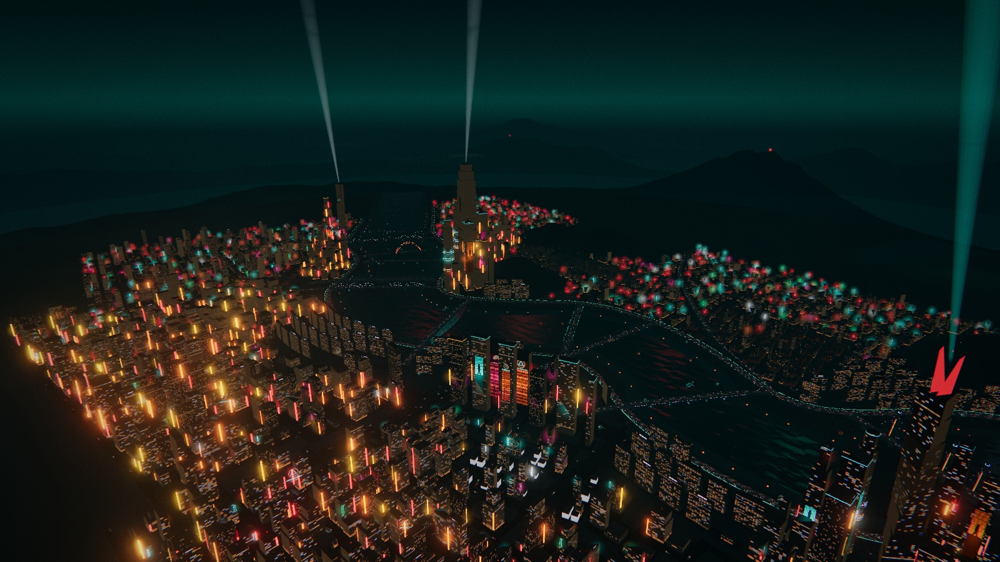
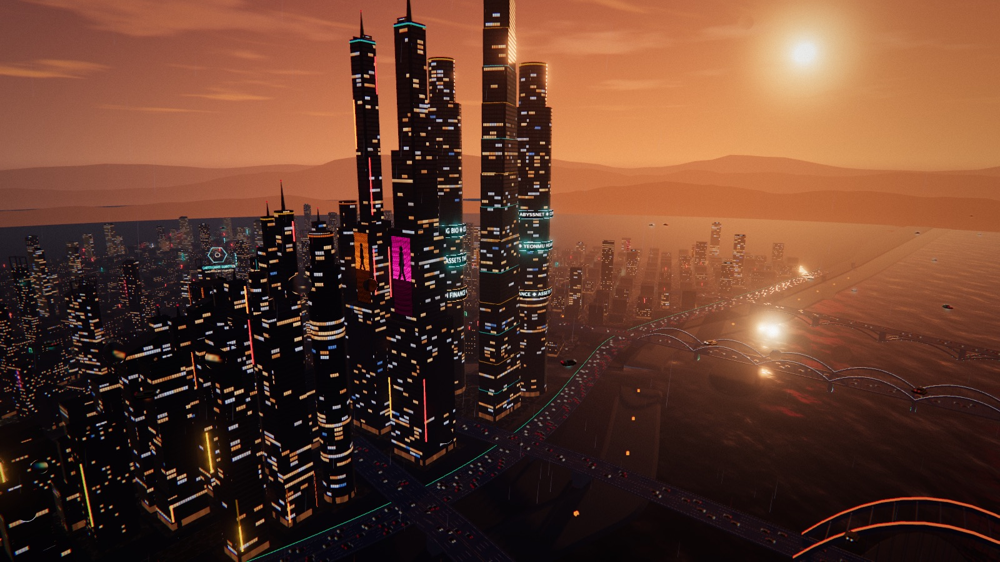
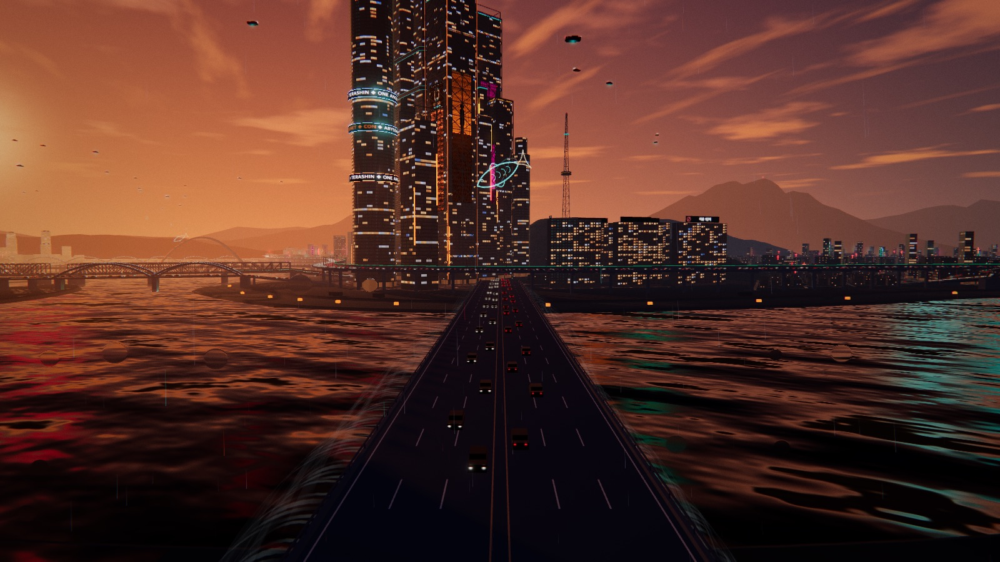
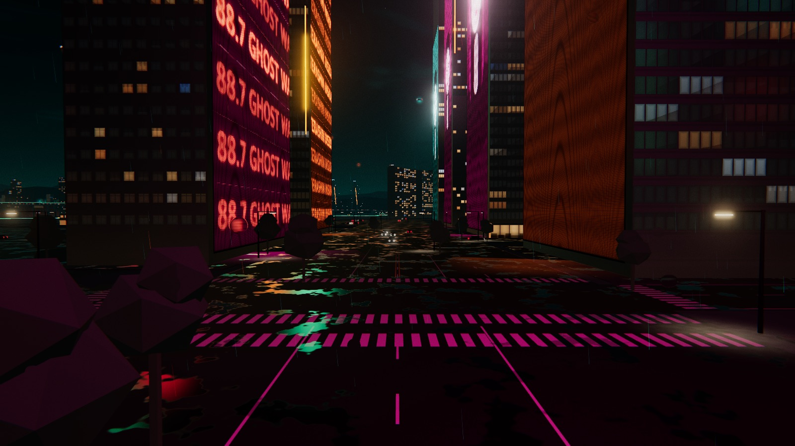
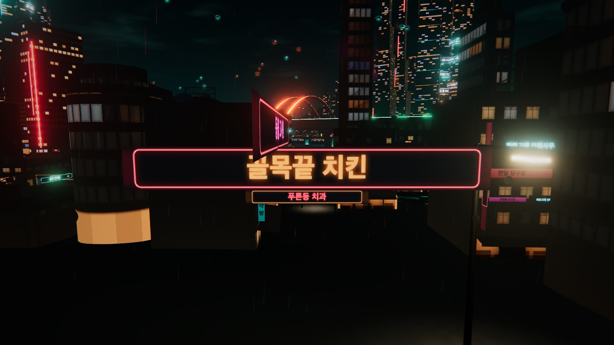
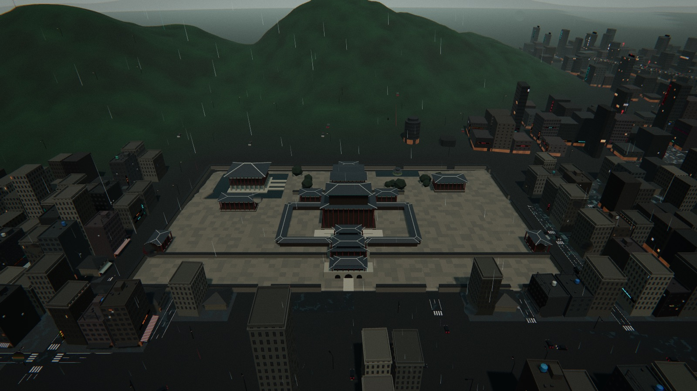

# Neon Megacity — 한강 (HANGANG)

미래의 서울을 사이버펑크 야경으로 옮긴, 브라우저에서 날아다니며 둘러보는 3D 도시입니다.
한강과 대교 11개, 남산과 북악, 용산·여의도·잠실의 타워, 종로와 경복궁, 홍대와 성수의 골목이 실제 서울의 자리에 놓여 있습니다.

**라이브 데모:** https://ldhbenecia.github.io/neon-megacity/



|                                                            |                                                       |
| ---------------------------------------------------------- | ----------------------------------------------------- |
|            |  |
|  |            |



three.js(r0.187), Vite, TypeScript(strict)로 만들었습니다. 텍스처와 효과는 모두 캔버스와 셰이더로 그 자리에서 만들고, 이미지나 모델 파일을 내려받지 않습니다.

## 둘러보기

| 입력                          | 동작                                                |
| ----------------------------- | --------------------------------------------------- |
| 왼쪽 드래그                   | 둘러보기(회전)                                      |
| 오른쪽 드래그, Shift+드래그   | 지면을 따라 이동                                    |
| 마우스 휠, 트랙패드 두 손가락 | 커서가 가리키는 곳으로 줌(핀치도 됩니다)            |
| 클릭                          | 건물 정보 카드 보기                                 |
| 더블클릭                      | 그 지점으로 이동                                    |
| `W` `A` `S` `D`, 방향키       | 앞뒤좌우 이동(높을수록 빠름)                        |
| `Q` / `E`                     | 내려가기 / 올라가기                                 |
| `Shift`                       | 세 배 빠르게                                        |
| `F`                           | 비행 모드(마우스로 시선, `Esc`로 끄기)              |
| `1` ~ `8`                     | 명소 시점(반포대교 남단, 여의도 상공, 남산에서 등)  |
| `C`                           | 시네마틱 카메라                                     |
| `R`                           | 처음 위치로                                         |
| `H`                           | 화면 정보 숨기기                                    |
| `?`                           | 조작법 보기                                         |
| `Esc`                         | 가장 위에 뜬 것부터 닫기                            |
| 터치                          | 한 손가락 회전, 두 손가락 줌과 이동, 탭은 건물 정보 |

오른쪽 위 버튼을 누르면 패널이 열립니다. 날씨(맑음, 비, 폭우), 명소 시점 8개, **구역으로 이동**(종로·광화문, 경복궁, 용산, 여의도, 강남·테헤란로, 잠실, 홍대, 성수 등), 화질(자동, 상, 중, 하), 시네마틱과 비행 모드를 고를 수 있습니다. 화면 아래 타임라인으로 시각을 바꾸거나 시간을 흐르게 할 수 있고, 왼쪽 위에는 지금 보고 있는 구역 이름이 나옵니다.

## 주소로 장면 지정하기

공유 링크나 스크린샷을 위해 주소 뒤에 값을 붙일 수 있습니다. 예: `?district=jongno&time=0.02`

| 파라미터        | 값                                                                                             | 설명                                     |
| --------------- | ---------------------------------------------------------------------------------------------- | ---------------------------------------- |
| `?time=0..1`    | `0` 자정, `0.25` 오전 6시, `0.5` 정오, `0.75` 오후 6시                                         | 시각을 고정합니다(시간 흐름 정지).       |
| `?cam=name`     | `banpo` `yeouido` `namsan` `teheran` `seongsu` `jamsil` `hongdae` `bugak` `overview` `topdown` | 그 시점에서 시작합니다.                  |
| `?preset=1..8`  | 명소 시점 번호                                                                                 | `?cam`이 없을 때 그 번호에서 시작합니다. |
| `?district=id`  | `jongno` `palace` `yongsan` `yeouido` 등 구역 id                                               | 그 구역의 대표 시점에서 시작합니다.      |
| `?rain=0..1`    | `0` 맑음 ~ `1` 폭우                                                                            | 처음 비의 세기를 정합니다.               |
| `?quality=name` | `high` `medium` `low`                                                                          | 화질 단계를 직접 고릅니다.               |
| `?hud=0`        | (값 없음)                                                                                      | 화면 정보를 숨긴 채 시작합니다.          |
| `?stats`        | (값 없음)                                                                                      | fps, draw call, 삼각형 수를 표시합니다.  |
| `?debug`        | (값 없음)                                                                                      | 개발자용 패널을 띄웁니다.                |
| `?notrack`      | (값 없음)                                                                                      | 이 방문의 통계를 보내지 않습니다.        |

범위를 벗어난 숫자는 0..1로 잘리고, 알 수 없는 값은 무시됩니다.

## 방문 통계

배포된 사이트는 방문 수와 사용 방식을 알기 위해 Google Analytics 4로 **익명 통계**를 보냅니다.

- 보내는 것: 방문, 부팅에 걸린 시간 구간, 화질 단계, 어떤 명소 시점과 구역 이동을 썼는지, 비행·시네마틱 모드 사용. 주소의 `?` 뒤 값은 보내지 않습니다.
- 보내지 않는 것: 개인 식별 정보, 정밀한 위치, 입력한 글자. 광고용 기능은 꺼 둡니다.
- 끄는 방법: 패널의 "방문 통계 보내기"를 끄거나, 주소에 `?notrack`을 붙이거나, 브라우저의 추적 거부(Do Not Track, Global Privacy Control)를 켭니다.
- 통계 스크립트는 도시가 다 뜬 뒤에 불러오고, 로컬 실행과 테스트에서는 불러오지 않습니다.

## 개발

Node 24 이상이 필요합니다.

```bash
npm ci                 # 의존성 설치
npm run dev            # 개발 서버 (Vite)
npm run build          # 타입 검사 + 프로덕션 빌드 (dist/)
npm run preview        # dist/ 미리보기
npm run typecheck      # tsc --noEmit
npm run lint           # ESLint (lint:fix 로 자동 수정)
npm run format:check   # Prettier 검사 (format 으로 자동 정리)
npm test               # Vitest 단위 테스트
npm run test:e2e       # Playwright 테스트 (오래 걸립니다)
npm run shots -- <이름> # 고정 장면 스크린샷과 검은 화면 검사 (screenshots/<이름>/)
npm run perf -- <이름>  # 실제 GPU 성능 측정 (프레임 시간, draw call, 메모리)
npm run size           # 번들 크기 검사
```

```
src/
  main.ts, boot.ts  렌더러, 카메라, 메인 루프, 부팅 순서
  core/             공유 타입, 시드 난수, URL 쿼리, 색 상수
  city/             지도 데이터의 단일 기준: 강, 대교, 도로, 구역, 건물, 산 (Web Worker에서 생성)
  lighting/         시간대, 해와 달, 하늘, 그림자, 노출
  terrain/          지면, 한강 수면과 둔치, 섬, 숲
  buildings/        도로와 보도, 건물, 창, 랜드마크, 경복궁
  infra/            대교, 고가도로, 터널 입구
  neon/             간판, 미디어 스크린, 가로등, 차량과 열차, 분수
  atmosphere/       안개, 비, 구름, 서치라이트, 후처리
  ux/               로딩 화면, 카메라 조작, 패널, 화질 선택, 방문 통계
tests/              Vitest 단위 테스트, tests/e2e/ 에 Playwright 테스트
scripts/            스크린샷, 성능 측정, 번들 크기
docs/               ARCHITECTURE, SEOUL(지도 설계), ART_DIRECTION, PERF
```

각 기능 폴더는 `init(ctx) -> { update(dt, elapsed), dispose() }` 형태의 모듈을 내보냅니다. 자세한 구조는 [docs/ARCHITECTURE.md](docs/ARCHITECTURE.md), 서울을 어떻게 옮겼는지는 [docs/SEOUL.md](docs/SEOUL.md), 성능 예산과 측정값은 [docs/PERF.md](docs/PERF.md)에 있습니다.

## CI와 배포

- **CI** (`ci.yml`): PR마다 포맷, 린트, 타입 검사, 단위 테스트, 빌드, 번들 크기를 검사합니다. main에서는 여기에 부팅 확인 테스트가 더해집니다.
- **Autofix** (`autofix.yml`): 같은 저장소의 PR에서 린트와 포맷 문제를 자동으로 고쳐 커밋합니다.
- **Pages** (`pages.yml`): main의 CI가 통과하면 GitHub Pages에 배포합니다.
- 전체 Playwright 테스트(`e2e-full.yml`)는 필요할 때 직접 실행합니다.

## 실제와 가상

- 지명, 대교, 산, 구역의 위치는 실제 서울을 따릅니다. 평면 축척은 약 1:6입니다.
- 경복궁은 실제 전각의 이름과 배치(광화문, 근정전, 경회루, 향원정 등)를 따릅니다.
- 현대의 건물은 실제 건물을 복제하지 않고 실루엣만 떠올리게 했습니다. 간판의 상호와 기업 이름은 모두 지어낸 것이고, 실제 브랜드와 로고는 쓰지 않습니다.

## 라이선스

[MIT](LICENSE)
